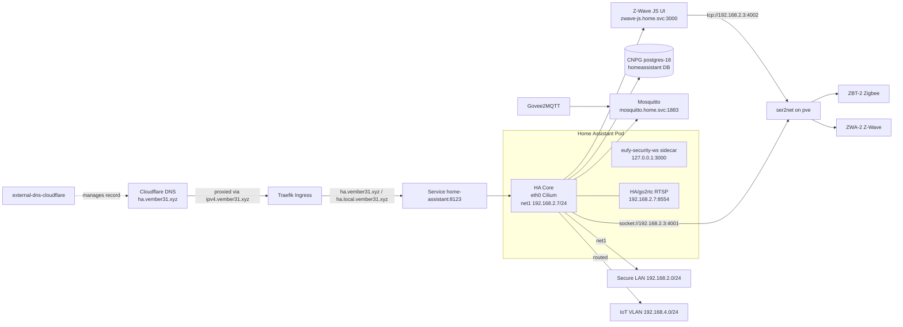

# Home Assistant: HAOS → Kubernetes Migration Runbook

**Status:** Phase 0 complete (Multus enabled and validated); Phase 1 not started  
**Last updated:** 2026-11-09  
**Target:** Home Assistant Container `2026.11.x` in the `home` namespace  
**Database:** CNPG `postgres-18` (`homeassistant` database)  
**Public DNS:** Traefik Ingress + `external-dns-cloudflare` (`ha.vember31.xyz`)  
**Networking prerequisite:** Multus CNI from `oci://ghcr.io/home-operations/charts/multus` (uses `ghcr.io/home-operations/cni-plugins`)

---

## 0. Recommendation in one page

- **Do not use `hostNetwork`.** Give the Home Assistant pod a real Layer 2 presence with **Multus**: `eth0` stays on Cilium for cluster traffic, and `net1` is a macvlan interface on `ens18` that keeps **`192.168.2.7/24`** and the existing HAOS MAC `02:96:57:5c:1a:5e`.
- Keep **Cilium as the primary CNI**. Multus is only used for the secondary LAN interface. Cilium must be switched to `cni.exclusive: false` before Multus is installed.
- Run HA as a **single-replica Deployment** with `strategy: Recreate`, **PostgreSQL** in the existing CNPG `postgres-18` cluster, and **one small 5 GiB Longhorn PVC** for `/config`. The PVC is unavoidable because HA writes `.storage` at runtime; the separate backups, media, and eufy PVCs are eliminated by using subdirectories on the same volume.
- Replace the HAOS add-ons with first-class Kubernetes Deployments:
  - **Mosquitto** Deployment (explicit local users; the HAOS HA-auth plugin is not available outside Supervisor).
  - **Z-Wave JS UI** Deployment, connecting to the ZWA-2 through `ser2net` on `pve`.
  - **eufy-security-ws** as a sidecar in the HA pod, preserving `127.0.0.1:3000`; any HA/go2rtc RTSP listener remains on `192.168.2.7:8554`.
  - **Govee2MQTT** Deployment, using the existing explicit `SCAN` IPs and MQTT credentials.
- Move the Zigbee and Z-Wave radios to a **ser2net gateway on `pve` (192.168.2.3)**. ZHA then uses `socket://192.168.2.3:4001`; Z-Wave JS uses `tcp://192.168.2.3:4002`. This avoids pinning HA to the node with the USB devices.
- Expose HA with **Traefik + external-dns** (Cloudflare provider) and keep `https://ha.vember31.xyz`. Do **not** run Cloudflared; remove the old HAOS Cloudflared add-on/tunnel and let external-dns own the public DNS record.
- Keep config backups on the config PVC (`/config/backups`) and upload them to **Google Drive** through the existing HA backup integration. The PostgreSQL recorder DB is covered by the CNPG scheduled backup to MinIO (add an S3/Barman object store if you want off-site DB backups too); the two restore paths are independent.
- Enable Multus in a **separate change window** before the HA cutover. The HA cutover itself should be a ~60–90 minute maintenance window.
- Keep HAOS VM 300 stopped but intact for **2–4 weeks** as the rollback path.

---

## 1. Why this design

### 1.1 Why Multus instead of `hostNetwork`

`hostNetwork: true` would be the shortest path, but it has real costs:

- It pins HA to a node (at least for port 8123 and any host-network discovery behavior).
- It makes the pod share the node's network namespace, so every host port/service on that node is visible to HA and vice versa.
- It makes rescheduling during k3s/Kured maintenance less predictable.
- It does not solve the radio transport problem; USB devices still pin the pod.

Multus gives the pod two interfaces:

| Interface | CNI | Purpose |
|---|---|---|
| `eth0` | Cilium | Cluster DNS, Services, Traefik ingress, external-dns, Mosquitto, Z-Wave JS |
| `net1` | Multus macvlan on `ens18` | `192.168.2.7/24`, mDNS/SSDP, LAN device discovery, direct LAN access |

The `sbr` (source-based routing) plugin makes traffic sourced from `192.168.2.7` use `net1` and its LAN gateway, while the pod's **main** default route stays on `eth0`, so cluster DNS and Kubernetes Services continue to work.

This also lets you reuse the existing HAOS IP and MAC. That is valuable: the UDM DHCP reservation, ARP entries, firewall rules, device integrations, and bookmarks can stay unchanged.

**Multus caveats to design around:**

- `net1` traffic bypasses Cilium policy and Hubble.
- Cluster pods should reach HA through the `Service` (`eth0`), not through `192.168.2.7`. A pod's macvlan address is not reliably reachable from other cluster pods.
- The HA pod cannot reach its **own node's** IP over `net1`; use `eth0` for anything node-local.
- Proxmox/switch MAC filtering must be off. The k3s VM NICs currently have no `firewall=1` on `net0`, so this should work, but test before cutover.
- Home Assistant must explicitly enable the `net1` adapter in **Settings → System → Network** (Advanced mode). Otherwise HA may still use `eth0` for discovery.
- Cilium must have `cni.exclusive: false`, or it will rename `00-multus.conf` to `00-multus.conf.cilium_bak` and Multus will silently stop working.

### 1.2 Why TCP serial instead of USB passthrough

The radios are currently USB devices passed through to HAOS VM 300 on `pve`:

```text
usb0: host=10c4:ea60   # stale/unused Silicon Labs CP210x; not visible in lsusb
usb1: host=303a:831a   # Home Assistant Connect ZBT-2 (Zigbee / ZHA)
usb2: host=303a:4001   # Home Assistant Connect ZWA-2 (Z-Wave JS)
```

Passing those through to a k3s VM would work, but it would tie HA to that node and make node maintenance/reboots a longer outage. A `ser2net` gateway on `pve` keeps the radios where they physically are, lets HA reschedule to any node, and is a supported Z-Wave JS / ZHA transport.

The trade-off is one extra network hop. Both the radios and the cluster are on the same wired `192.168.2.0/24` VLAN, so this is a low-latency local link, not Wi-Fi/WAN/VPN. Do **not** use this over Wi-Fi or a VPN.

Fallback if TCP serial proves unreliable: pass the USB devices through to `k3s-control1` (VM 401 on `pve`) and pin the radio pods to that node with `nodeAffinity` plus `hostPath` mounts for `/dev/serial/by-id`. That is lower latency but less flexible and makes that node the radio single point of failure.

**Why not Zigbee2MQTT for this cutover?** Z2M is a good product, but moving from ZHA changes the integration layer: Z2M creates new MQTT-discovered entities and unique IDs, so entity IDs and device-based automations need remapping. With 1,487 entities and 46 automations, that is a separate project, not part of the HAOS→Kubernetes move. Keep ZHA for v1. If you migrate to Z2M later, it can also connect to `ser2net` via `tcp://192.168.2.3:4001`, so pinning the pod to the USB node is not required.

### 1.3 Why PostgreSQL and one small PVC

The current recorder database is `home-assistant_v2.db`, about 700 MB, plus WAL/SHM files. There is no `recorder:` override in `configuration.yaml`, so it is using the default SQLite recorder with the default purge window.

Moving the recorder to the existing CloudNative-PG `postgres-18` cluster has real benefits:

- The database is no longer on the HA config volume; the config PVC becomes small.
- CNPG already has three instances, monitoring, and a daily `ScheduledBackup` to MinIO with 30-day retention.
- The HA pod can be rescheduled without carrying a 700 MB SQLite file and its WAL on Longhorn.
- Restore is split cleanly: config from HA native backups/Google Drive, database from CNPG/Barman.

The trade-off is explicit: **Home Assistant does not migrate recorder history or long-term statistics from SQLite to PostgreSQL automatically.** This runbook treats the Postgres recorder as a fresh database. Keep the old `home-assistant_v2.db` and the pre-migration HAOS backup archived if you want the old history for reference. If you need the history in Postgres, plan a separate SQLite→Postgres migration before the cutover; do not make it part of the cutover window.

**Storage:** one PVC is unavoidable because Home Assistant writes `.storage`, the entity/device registry, `zigbee.db`, and HACS state at runtime. A ConfigMap/Secret-only config would be read-only and would break HA. The design uses **one 5 GiB PVC** and puts the other data in subdirectories:

- `/config` — HA config, `.storage`, `custom_components`, `www`, `zigbee.db`
- `/config/backups` — HA native config backups (small now that history is in Postgres)
- `/media` — subPath `media` (the old media folder is only ~56 KB)
- `/data` for the eufy sidecar — subPath `eufy` (a few KB of persistent login state)

This avoids separate config/backups/media/eufy PVCs in favor of one 5 GiB volume, plus the small Mosquitto and Z-Wave store volumes described later.

### 1.4 Why external-dns + Traefik instead of Cloudflared

The repo already has everything needed to publish `ha.vember31.xyz` without a tunnel connector:

- `external-dns-cloudflare` watches Ingress/IngressRoute resources and creates Cloudflare records.
- `cloudflare-ddns` keeps `ipv4.${SECRET_DOMAIN}` pointed at the current public IP.
- `cert-manager` uses a Cloudflare DNS-01 ClusterIssuer, so certificates work even when the record is Cloudflare-proxied.
- Existing public services (Outline, Seerr, Bookorbit, etc.) already use the `external-dns.kubernetes.io/target: "ipv4.${SECRET_DOMAIN}"` pattern.

The HA setup becomes a normal public Ingress:

- `ha.vember31.xyz` → Cloudflare proxy → `ipv4.${SECRET_DOMAIN}` → Traefik → HA Service.
- `ha.local.vember31.xyz` stays as the internal ingress for LAN clients.
- No Cloudflared Deployment, no tunnel credentials, and no duplicate-connector problem.

Requirement: inbound 80/443 must reach Traefik from Cloudflare. The repo already exposes other services this way, so the path exists. Remove the old Cloudflared route/CNAME for `ha.vember31.xyz` before applying the external ingress so external-dns is the only owner of that name.

Security: use the existing `networking-external-with-errors` middleware and consider the same Cloudflare Access/CrowdSec protections used by other public services. HA should also have strong authentication and 2FA.

### 1.5 What stays the same

- External URL: `https://ha.vember31.xyz`
- Internal IP: `192.168.2.7`
- HA config, `.storage`, entity registry, device registry, dashboards, HACS components
- Zigbee network on the ZBT-2 and Z-Wave network on the ZWA-2
- Automations, scripts, scenes, Keymaster, templates
- Google Drive backup destination (recheck OAuth after migration)

### 1.6 What migrates from HAOS — and what does not

The migration copies the **entire Home Assistant config directory** from a settings-only backup into the new `/config` PVC. PostgreSQL only replaces the recorder database; it does not change where configuration lives.

| Item | Migrates? | Notes |
|---|---|---|
| `configuration.yaml`, `automations.yaml`, `scripts.yaml`, `scenes.yaml` | **Yes** | Copied from the backup |
| `.storage/` — entity, device, area, floor, label registries | **Yes** | Preserves entity IDs, device IDs, areas, labels |
| `.storage/` — config entries, auth/users, long-lived tokens, dashboards | **Yes** | Users/tokens remain; rotate sensitive tokens |
| Dashboards, themes, blueprints, `www/`, HACS `custom_components` | **Yes** | HACS requirements reinstall at startup |
| `zigbee.db` (ZHA network/device DB) | **Yes** | Coordinator network stays on the ZBT-2 |
| Integration configs (Hue, Nest, Ecobee, UniFi, Plex, ESPHome, etc.) | **Yes** | Endpoint changes are limited to MQTT/ZHA/Z-Wave/eufy |
| Physical Zigbee/Z-Wave devices | **Yes** | Same ZBT-2/ZWA-2 + network keys; no re-pairing if you edit the existing integrations in place |
| Add-ons themselves (Mosquitto, Z-Wave JS, Cloudflared, etc.) | **No** | Replaced by Kubernetes Deployments; Cloudflared is removed |
| Add-on data (Z-Wave keys/store, eufy `persistent.json`, MQTT retained messages) | **Partial/manual** | Z-Wave keys must be copied; eufy persistent is optional; MQTT retained messages are not copied |
| Supervisor/OS/add-on update entities and `hassio.*` services | **No** | Supervisor integration is removed; audit automations/dashboards |
| Recorder history, logbook history, long-term statistics | **No** | Postgres starts fresh; old SQLite DB is archived |
| Cloud OAuth tokens (Google Drive, Nest, etc.) | **Mostly yes** | Tokens are in `.storage`; some may need reauthorization |
| Media/share folders | **Optional** | Media is only ~56 KB; copy it if used |

**Device/entity ID caution:** edit the existing ZHA/Z-Wave/MQTT config entries in place (ZHA “Migrate Radio”, Z-Wave JS URL, MQTT broker) rather than deleting and re-adding them. Removing an integration can recreate device-registry entries and break automations that use `device_id`. Entity-ID-based automations usually survive because unique IDs are stable, but verify device-based triggers/conditions after cutover.

---

## 2. Current state (discovered 2026-11-08)

### 2.1 HAOS / VM

| Item | Value |
|---|---|
| Proxmox host | `pve` — `192.168.2.3` |
| VMID / name | `300` / `home-assistant` |
| Resources | 2 vCPU, 4 GB RAM, 32 GB disk |
| HAOS | 18.4 |
| Home Assistant Core | 2026.11.0 |
| Supervisor | 2026.10.5 |
| IP / MAC | `192.168.2.7/24` / `02:96:57:5c:1a:5e` |
| External URL | `https://ha.vember31.xyz` via Cloudflared add-on (to be removed) |
| Internal URL | `null` (clients use the external URL) |
| Config dir size | ~737 MB |
| SQLite DB | ~700 MB + ~5 MB WAL/SHM (archived; not migrated) |
| Local backups | `/mnt/data/supervisor/backup`, ~4.4 GB |
| Latest automatic backup | `automatic_backup_2026_11_0_2026-11-08_05.02_25002470.tar`, ~173 MB, encrypted (protected) |
| Google Drive backup | Configured and receiving the same automatic backups |

### 2.2 Scale

| Item | Count |
|---|---:|
| Entities | 1,487 |
| Config entries | 53 |
| Automations | 46 |
| Scenes | 34 |
| Scripts | 12 |
| Dashboards | 3 (`home-dashboard`, `map`, `dashboard-keymaster`) |
| HACS custom integrations | Keymaster, Local Tuya, Pirate Weather, Eufy Security, Goveelife, Sun2, SmartThinQ LGE Sensors, Sonoff LAN, smartlife, plus frontend cards/themes |

### 2.3 Add-ons

| Add-on | Version | Notes |
|---|---:|---|
| File editor | 6.3.0 | Not needed in k8s; use `kubectl exec`/VSCode |
| Terminal & SSH | 10.6.0 | Not needed in k8s; use `kubectl exec` |
| Cloudflared | 7.0.21 | `external_hostname: ha.vember31.xyz`; credentials in app data |
| eufy-security-ws | 3.1.0 | Host network; HA integration points at `127.0.0.1:3000` |
| Mosquitto broker | 7.1.3 | No local logins; uses HA auth plugin |
| Govee to MQTT Bridge | 2026.03.25-ab9deb66 | Host network; `scan: 192.168.4.35,192.168.4.135` |
| Z-Wave JS | 1.10.0 | ZWA-2 serial path; network/S2 keys in options |

### 2.4 Radios and serial paths

| Radio | USB ID | HAOS serial path | Used by |
|---|---|---|---|
| Home Assistant Connect ZBT-2 | `303a:831a` | `/dev/serial/by-id/usb-Nabu_Casa_ZBT-2_DCB4D9113140-if00` | ZHA, `ezsp`, 460800 baud, hardware flow control |
| Home Assistant Connect ZWA-2 | `303a:4001` | `/dev/serial/by-id/usb-Nabu_Casa_ZWA-2_1020BA7105E4-if00` | Z-Wave JS |
| Silicon Labs CP210x | `10c4:ea60` | not currently visible on `pve` | **Probably stale**; verify before migrating |

### 2.5 Current integration wiring that must change

From `.storage/core.config_entries`:

| Integration | Current | Target |
|---|---|---|
| `hassio` (Supervisor) | Present | Delete after restore |
| `mqtt` | `broker: core-mosquitto`, user `homeassistant` | `mosquitto.home.svc.cluster.local:1883` + local password |
| `zha` | `/dev/serial/by-id/usb-Nabu_Casa_ZBT-2_DCB4D9113140-if00`, 460800, hardware flow control | `socket://192.168.2.3:4001` |
| `zwave_js` | `ws://core-zwave-js:3000`, `use_addon: true`, USB path | `ws://zwave-js.home.svc.cluster.local:3000`, `use_addon: false`; keep the same network/S2 keys |
| `eufy_security` | `127.0.0.1:3000`, RTSP `127.0.0.1:8554` | Keep `127.0.0.1` with a sidecar; cameras use `192.168.2.7:8554` if needed |
| `homeassistant_connect_zbt2` | Present | Remove/ignore; firmware updates are not available over TCP serial |
| `recorder` | SQLite default (`home-assistant_v2.db`) | PostgreSQL via `recorder.db_url`; history is fresh |
| `backup` / `google_drive` | Present | Keep; config-only backups to Google Drive; recheck OAuth |

### 2.6 MQTT clients observed

The Mosquitto log shows the HA connection plus one external client from `192.168.2.188` (Intel MAC, likely a workstation/panel). The add-on currently authenticates clients through the Home Assistant auth plugin. Before cutover, identify every non-local MQTT client and decide:

- Give it a local Mosquitto user and update its config, or
- Decommission it.

If a client hardcodes `192.168.2.7:1883`, it will fail after cutover unless Mosquitto is given a LAN presence (Multus or MetalLB) or the client is updated.

### 2.7 Cluster / CNI

| Item | Value |
|---|---|
| k3s | v1.37.2+k3s1, 3 control planes + 5 workers |
| Primary CNI | Cilium 1.20.4, `cni.exclusive: true` currently |
| CNI config dir | `/etc/cni/net.d` (`05-cilium.conflist`) |
| CNI bin dir | `/opt/cni/bin` (`cilium-cni`, `loopback`) |
| Node interface | `ens18` on all 8 nodes |
| Multus | CRD exists, **no Multus DaemonSet running** |
| StorageClass | `longhorn` (default, 2 replicas) |
| Longhorn backup target | `nfs://192.168.2.9:/backup`, daily `10 7 * * *` UTC, retain 1 |
| CNPG | `postgres-18` healthy; will host the HA recorder database |
| Ingress | Traefik `192.168.10.20`, cert-manager, external-dns Cloudflare |
| Public DNS helper | `cloudflare-ddns` maintains `ipv4.${SECRET_DOMAIN}` |
| Cloudflared in cluster | Not installed; the HAOS add-on/tunnel is being removed |

---

## 3. Target architecture



### 3.1 Component map

| Component | Namespace | Kind | Notes |
|---|---|---|---|
| `home-assistant` | `home` | Deployment + Service + 2 Ingresses | Multus `net1`; eufy sidecar |
| `postgres-18` | `database` | CNPG Cluster (existing) | Recorder DB `homeassistant`; daily Barman backup |
| `mosquitto` | `home` | Deployment + Service | 1883 ClusterIP; local users |
| `zwave-js` | `home` | Deployment + Service | Z-Wave JS UI; ws 3000, UI 8091 |
| `govee2mqtt` | `home` | Deployment + Service | 8056 optional UI |
| `external-dns-cloudflare` | `networking` | Deployment (existing) | Owns `ha.vember31.xyz` |
| `cloudflare-ddns` | `networking` | Deployment (existing) | Maintains `ipv4.${SECRET_DOMAIN}` |
| `multus` | `kube-system` | DaemonSet | Chart `0.1.1`, CNI plugins `1.9.1` |
| `lan` NAD | `networking` | NetworkAttachmentDefinition | macvlan on `ens18`, static + sbr |
| `ser2net` | `pve` host | systemd service | 4001 Zigbee / 4002 Z-Wave |

### 3.2 IP / MAC plan

| Address | Owner | Notes |
|---|---|---|
| `192.168.2.7` | HA pod `net1` | Reuses the old HAOS IP/MAC; HAOS must be stopped |
| `192.168.2.77` | Temporary Multus test pod | Free address outside DHCP pool; delete after test |
| `192.168.2.3` | `pve` ser2net | 4001/4002, restricted to the cluster/LAN |
| `192.168.2.188` | Unknown MQTT client | Identify before rotating broker credentials |

Reusing the old HAOS MAC is recommended. It keeps the UDM DHCP reservation and ARP behavior stable. The old HAOS VM must never be started while the HA pod is running.

---

## 4. Decisions to make before starting

| Decision | Recommendation | Alternative |
|---|---|---|
| Secondary network | **Secure LAN `lan` NAD on `ens18`**, keep `.7` | IoT VLAN NAD on `ens18.<vlan>` for direct L2 to `192.168.4.0/24` |
| MAC address | **Reuse `02:96:57:5c:1a:5e`** via the Multus annotation | Let macvlan pick a random MAC and update the UDM reservation |
| Zigbee integration | **Keep ZHA; use Migrate Radio to `socket://`** | Zigbee2MQTT (separate entity-remapping project) |
| Radio transport | **ser2net on `pve`; no pod pinning** | USB passthrough to one k3s node + `nodeAffinity` |
| Database | **CNPG `postgres-18`, fresh `homeassistant` DB** | Keep SQLite (not chosen) |
| Recorder history | **Accept a fresh recorder; archive the old SQLite DB** | Separate SQLite→Postgres migration before cutover |
| Storage | **One 5 GiB Longhorn PVC with `backups`/`media`/`eufy` subPaths** | Separate PVCs (not recommended) |
| External access | **Traefik + external-dns Cloudflare**, keep `ha.vember31.xyz` | Cloudflared tunnel (not chosen) |
| eufy-security-ws | **Sidecar in the HA pod** | Separate Deployment with its own Multus LAN IP |
| Govee2MQTT | **Separate Deployment, explicit `SCAN` IPs** | Add an `iot` NAD and use L2 discovery |
| HA config source | **PVC seeded from a settings-only backup** | Externalize static YAML into Git later |
| Config cloud backup | **HA native backup + Google Drive** | Longhorn/NFS only; add S3/rclone later |
| MQTT external clients | **Inventory and migrate** | Give Mosquitto a LAN IP/MetalLB if needed |

---

## 5. Phase 0 — Enable Multus (separate change window)

Do this before the HA cutover. It changes the CNI on every node, so treat it as its own maintenance item and validate with a test pod before touching HA.

### 5.1 Pre-flight checks

Run these from a machine with `kubectl` and root SSH to `pve`:

```bash
# 1. Confirm the current Cilium CNI configuration.
kubectl -n kube-system get cm cilium-config -o yaml | grep -E 'cni-exclusive|conf-path|bin-path'

# 2. Confirm the Multus CRD exists.
kubectl get crd network-attachment-definitions.k8s.cni.cncf.io

# 3. Confirm no Multus DaemonSet is already running.
kubectl get ds -A | grep -i multus || echo "no multus daemonset"

# 4. Confirm node interface names (all should be ens18).
for n in k3s-control1 k3s-control3 k3s-control4 k3s-gpu-worker \
         k3s-worker1 k3s-worker2 k3s-worker3 k3s-worker4; do
  echo "=== $n ==="
  kubectl debug node/$n -it --image=alpine:3.22 --profile=sysadmin -- \
    chroot /host sh -c 'ip -br link | grep -v -E "lo|cilium|veth|lxc|docker|dummy"'
done

# 5. Confirm CNI paths and existing binaries on one node.
# NOTE: use -i. Without it, kubectl debug does not attach stdout and the command
# produces no visible output (the output is still available in the debug pod's logs).
kubectl debug node/k3s-control1 -it --image=alpine:3.22 --profile=sysadmin -- \
  chroot /host sh -c 'ls -la /etc/cni/net.d /opt/cni/bin'

# 6. Confirm the Proxmox NICs do not have MAC filtering enabled.
ssh root@192.168.2.3 'qm config 401 | grep ^net0; qm config 402 | grep ^net0'
# Observed: net0: virtio=...,bridge=vmbr0,firewall=1 — firewall=1 is present on
# the k3s VMs, but the host firewall is disabled (`pve-firewall status` shows
# "disabled/running") and there are no /etc/pve/firewall/<vmid>.fw files, so
# firewall=1 is inert and no MAC filter applies. Verify both of those before
# assuming MAC filtering is off.
```

**Expected current CNI state:**

```text
/etc/cni/net.d/05-cilium.conflist
/opt/cni/bin/cilium-cni
/opt/cni/bin/loopback
```

If there are stale `*.cilium_bak` files or old CNI configs, clean them up **before** changing Cilium. Only `05-cilium.conflist` should remain.

### 5.2 Set Cilium `cni.exclusive: false`

Edit `kubernetes/apps/kube-system/cilium/app/helmrelease.yaml`:

```yaml
    # Cilium must not delete Multus's 00-multus.conf.
    cni:
      exclusive: false
```

Commit this **alone first**, then reconcile:

```bash
flux reconcile helmrelease cilium -n kube-system --with-source
kubectl -n kube-system rollout status ds/cilium --timeout=10m
```

Verify on every node:

```bash
for n in k3s-control1 k3s-control3 k3s-control4 k3s-gpu-worker \
         k3s-worker1 k3s-worker2 k3s-worker3 k3s-worker4; do
  echo "=== $n ==="
  kubectl debug node/$n -it --image=alpine:3.22 --profile=sysadmin -- \
    chroot /host sh -c 'ls -la /etc/cni/net.d; grep -o "\"name\": \"[^\"]*\"" /etc/cni/net.d/*.conflist 2>/dev/null'
done
```

Expected: only `05-cilium.conflist`. No `00-multus.conf` yet. No `.cilium_bak` files.

### 5.3 Install the Multus chart and CNI plugins

Add the OCI source in `kubernetes/flux/repositories/oci/multus.yaml`:

```yaml
---
apiVersion: source.toolkit.fluxcd.io/v1
kind: OCIRepository
metadata:
  name: multus
  namespace: flux-system
spec:
  interval: 1h
  layerSelector:
    mediaType: application/vnd.cncf.helm.chart.content.v1.tar+gzip
    operation: copy
  ref:
    tag: 0.1.1
  url: oci://ghcr.io/home-operations/charts/multus
```

Add `./multus.yaml` to `kubernetes/flux/repositories/oci/kustomization.yaml`.

Create `kubernetes/apps/networking/multus/app/helmrelease.yaml`:

```yaml
---
# yaml-language-server: $schema=https://k8s-schemas.home-operations.com/helm.toolkit.fluxcd.io/helmrelease_v2.json
apiVersion: helm.toolkit.fluxcd.io/v2
kind: HelmRelease
metadata:
  name: multus
  namespace: kube-system
spec:
  interval: 1h
  chartRef:
    kind: OCIRepository
    name: multus
    namespace: flux-system
  install:
    timeout: 10m
    replace: true
    crds: CreateReplace
    remediation:
      retries: 3
  upgrade:
    cleanupOnFail: true
    remediation:
      strategy: rollback
      retries: 3
    crds: CreateReplace
  values:
    resources:
      requests:
        cpu: 10m
      limits:
        memory: 64Mi
    # k3s uses the containerd CRI defaults on these nodes.
    cni:
      netDir: /etc/cni/net.d
      binDir: /opt/cni/bin
    # Copy macvlan/sbr/etc. onto the host; Cilium/loopback are left alone.
    cniPlugins:
      enabled: true
```

Create `kubernetes/apps/networking/multus/app/kustomization.yaml`:

```yaml
---
apiVersion: kustomize.config.k8s.io/v1beta1
kind: Kustomization
resources:
  - ./helmrelease.yaml
```

Create `kubernetes/apps/networking/multus/ks.yaml` with both the Multus and network Kustomizations:

```yaml
---
apiVersion: kustomize.toolkit.fluxcd.io/v1
kind: Kustomization
metadata:
  name: &app multus
  namespace: flux-system
spec:
  targetNamespace: kube-system
  commonMetadata:
    labels:
      app.kubernetes.io/name: *app
  dependsOn:
    - name: cilium
  path: ./kubernetes/apps/networking/multus/app
  prune: true
  sourceRef:
    kind: GitRepository
    name: flux-system
  wait: true
  interval: 30m
  retryInterval: 1m
  timeout: 5m
---
apiVersion: kustomize.toolkit.fluxcd.io/v1
kind: Kustomization
metadata:
  name: &app multus-networks
  namespace: flux-system
spec:
  targetNamespace: networking
  commonMetadata:
    labels:
      app.kubernetes.io/name: *app
  dependsOn:
    - name: multus
  path: ./kubernetes/apps/networking/multus/networks
  prune: true
  sourceRef:
    kind: GitRepository
    name: flux-system
  wait: true
  interval: 30m
  retryInterval: 1m
  timeout: 5m
```

Add `./multus/ks.yaml` to `kubernetes/apps/networking/kustomization.yaml`.

Commit and reconcile:

```bash
flux reconcile kustomization multus --with-source
kubectl -n kube-system rollout status ds/multus --timeout=10m
kubectl -n kube-system get ds/multus -o wide
kubectl -n kube-system logs ds/multus --tail=50
```

Verify on every node:

```bash
kubectl debug node/k3s-control1 -it --image=alpine:3.22 --profile=sysadmin -- \
  chroot /host sh -c 'ls -la /etc/cni/net.d /opt/cni/bin'
```

Expected:

```text
/etc/cni/net.d/00-multus.conflist
/etc/cni/net.d/05-cilium.conflist
/etc/cni/net.d/multus.d/multus.kubeconfig
/opt/cni/bin/cilium-cni
/opt/cni/bin/loopback
/opt/cni/bin/macvlan
/opt/cni/bin/multus
/opt/cni/bin/sbr
```

Note: chart `0.1.1` writes `00-multus.conflist` (not `00-multus.conf`). The generated
conflist embeds the Cilium config as its delegate, so `eth0` still uses Cilium.

If `00-multus.conflist.cilium_bak` exists, Cilium is still exclusive. Fix the Cilium value and restart/rollout Cilium before continuing.

### 5.4 Create the `lan` NetworkAttachmentDefinition

Create `kubernetes/apps/networking/multus/networks/lan.yaml`:

```yaml
---
# yaml-language-server: $schema=https://k8s-schemas.home-operations.com/k8s.cni.cncf.io/networkattachmentdefinition_v1.json
apiVersion: k8s.cni.cncf.io/v1
kind: NetworkAttachmentDefinition
metadata:
  name: lan
  namespace: networking
spec:
  config: |-
    {
      "cniVersion": "1.1.0",
      "name": "lan",
      "plugins": [
        {
          "type": "macvlan",
          "master": "ens18",
          "mode": "bridge",
          "capabilities": { "ips": true, "mac": true },
          "ipam": {
            "type": "static",
            "routes": [
              { "dst": "0.0.0.0/0", "gw": "192.168.2.1" },
              { "dst": "192.168.3.0/24", "gw": "192.168.2.1" },
              { "dst": "192.168.4.0/24", "gw": "192.168.2.1" }
            ]
          }
        },
        { "type": "sbr" }
      ]
    }
```

Create `kubernetes/apps/networking/multus/networks/kustomization.yaml`:

```yaml
---
apiVersion: kustomize.config.k8s.io/v1beta1
kind: Kustomization
resources:
  - ./lan.yaml
```

Notes:

- `master: ens18` is correct for all current nodes. If a node is rebuilt with a different NIC name, either fix the NAD or create a per-node NAD.
- The NAD includes a default route via `192.168.2.1`, but `sbr` moves the `net1` routes into a source-based table for `192.168.2.7`. The pod's main default route must remain via `eth0`; verify this in the test pod. This avoids the macvlan asymmetric-routing problem for `.7`-sourced traffic.
- The routes for `192.168.3.0/24` and `192.168.4.0/24` are optional but useful for direct access to the guest/IoT VLANs. Add more VLAN routes if needed.
- Do not use `ipvlan` here. Macvlan in `bridge` mode preserves multicast/broadcast behavior needed for discovery.

### 5.5 Test with a temporary pod at `192.168.2.77`

Do this **before** stopping HAOS. Use a free address and a different MAC from the old HAOS.

```yaml
---
apiVersion: v1
kind: Pod
metadata:
  name: multus-lan-test
  namespace: networking
  annotations:
    k8s.v1.cni.cncf.io/networks: >-
      [{"name":"lan","namespace":"networking","interface":"net1","ips":["192.168.2.77/24"],"mac":"02:96:57:5c:1a:77"}]
spec:
  restartPolicy: Never
  containers:
    - name: netshoot
      image: nicolaka/netshoot:v0.16
      command: ["sleep", "infinity"]
```

```bash
kubectl -n networking apply -f multus-lan-test.yaml
kubectl -n networking wait --for=condition=Ready pod/multus-lan-test --timeout=2m

kubectl -n networking exec multus-lan-test -- ip -br addr
kubectl -n networking exec multus-lan-test -- ip route
kubectl -n networking exec multus-lan-test -- ip rule
kubectl -n networking exec multus-lan-test -- ping -c1 192.168.2.1
kubectl -n networking exec multus-lan-test -- dig +short kubernetes.default.svc.cluster.local
kubectl -n networking exec multus-lan-test -- curl -sS -m 5 -o /dev/null -w '%{http_code}\n' http://192.168.2.1
```

Expected:

- `eth0` has a `10.42.x.x` pod IP and the **main** default route.
- `net1` has `192.168.2.77/24` and MAC `02:96:57:5c:1a:77`.
- `ip rule` has a `from 192.168.2.77 lookup 100` rule.
- `ip route show table 100` has the `192.168.2.0/24` connected route, the VLAN routes, and a default via `192.168.2.1`.
- DNS resolves the Kubernetes service (proves the main default/route to CoreDNS still works).
- Ping to the UDM gateway works.

If ping fails, check:

- Proxmox VM NIC MAC filtering (`firewall=1` on `net0`).
- UDM switch port security.
- The node's `ens18` is up and on the correct bridge.
- The `sbr` plugin is installed and the CNI config is valid.

Delete the test pod:

```bash
kubectl -n networking delete pod multus-lan-test
```

### 5.6 Multus rollback

If Multus causes CNI problems:

```bash
# Remove the multus and multus-networks Kustomizations from Git, then:
flux reconcile kustomization multus-networks --with-source
flux reconcile kustomization multus --with-source
```

Verify `/etc/cni/net.d/00-multus.conflist` is gone on each node. If it is not, remove it manually via `kubectl debug node/...`. Leave Cilium `cni.exclusive: false` until Multus is fully removed; then you can revert it to `true` if desired.

Do not remove Multus while the HA pod is using `net1`; stop HA first.

---

## 6. Phase 1 — Prepare HA and supporting services

Do as much of this as possible **before** the cutover. Everything except the radio-connected services and the HA pod itself can be staged.

### 6.1 Secrets inventory

Store these in GitLab CI/CD variables (or Vaultwarden + ExternalSecret). Do **not** commit them.

| Variable | Used by | Notes |
|---|---|---|
| `HASS_SECRETS_YAML` | HA `secrets.yaml` | Optional; keep on PVC for v1 |
| `HASS_TOKEN` | Homepage widget | Rotate after cutover |
| `MQTT_HOMEASSISTANT_PASSWORD` | HA MQTT integration | New local Mosquitto user |
| `MQTT_GOVEE_PASSWORD` | Govee2MQTT | New local Mosquitto user |
| `MOSQUITTO_PASSWD` | Mosquitto `passwd` file | Output of `mosquitto_passwd` |
| `GOVEE_EMAIL`, `GOVEE_PASSWORD`, `GOVEE_API_KEY` | Govee2MQTT | Copy from the add-on options |
| `EUFY_USERNAME`, `EUFY_PASSWORD` | eufy-security-ws sidecar | Copy from the add-on options |
| `HASS_POSTGRES_USER`, `HASS_POSTGRES_PASS` | HA recorder + `postgres-init` | New role/database for HA |
| `ZWAVE_*` keys | Z-Wave JS UI | Copy from the add-on options / HA config entry; store in a password manager too |

The Z-Wave S0/S2 keys are the most dangerous thing to lose. If they are wrong, secure devices will not communicate. Keep the old HAOS VM until the Z-Wave network is fully validated.

The repo's External Secrets pattern applies here. A generic shape:

```yaml
apiVersion: external-secrets.io/v1
kind: ExternalSecret
metadata:
  name: <secret-name>
  namespace: <namespace>
spec:
  secretStoreRef:
    name: gitlab-secret-store
    kind: ClusterSecretStore
  target:
    name: <secret-name>
  dataFrom:
    - extract:
        key: home-assistant
```

Adapt per app:

- `eufy-security-ws`: Secret keys `username` / `password`.
- `govee2mqtt-secret`: Secret keys `GOVEE_EMAIL`, `GOVEE_PASSWORD`, `GOVEE_API_KEY`, `MQTT_USERNAME`, `MQTT_PASSWORD`.
- `mosquitto-auth`: Secret key `passwd` (the full `mosquitto_passwd` file). Use an explicit `data` entry with `property: MOSQUITTO_PASSWD` if the variable is stored separately.
- `home-assistant-db`: Secret keys `HASS_DB_URL`, `INIT_POSTGRES_DBNAME`, `INIT_POSTGRES_HOST`, `INIT_POSTGRES_USER`, `INIT_POSTGRES_PASS`, and `INIT_POSTGRES_SUPER_PASS`. The superuser password comes from the existing `cloudnativepg` GitLab key, which is already used by the other CNPG apps.

Do not put these values in `values.yaml`, ConfigMaps, or the Git repository.

### 6.2 Pre-create the HA PVC

Create `kubernetes/apps/home/home-assistant/app/pvc.yaml`:

```yaml
---
apiVersion: v1
kind: PersistentVolumeClaim
metadata:
  name: home-assistant-config
  namespace: home
  annotations:
    kustomize.toolkit.fluxcd.io/prune: disabled
  labels:
    recurring-job-group.longhorn.io/default: enabled
spec:
  accessModes: [ReadWriteOnce]
  storageClassName: longhorn
  resources:
    requests:
      storage: 5Gi
```

Notes:

- One PVC is the minimum: HA writes `.storage`, the registries, `zigbee.db`, `custom_components`, and `www` at runtime. A read-only ConfigMap/Secret cannot replace it.
- With the recorder in PostgreSQL, the config directory is only ~40 MB. The 5 GiB volume leaves room for several compressed config backups and the old media folder.
- `/config/backups` is a normal directory on this PVC. HA Container stores native backups there; no separate backups PVC is needed.
- `/media` is mounted from the `media` subPath of the same PVC (the old media folder is ~56 KB).
- `/data` for the eufy sidecar is mounted from the `eufy` subPath of the same PVC. It preserves the Eufy persistent login/trusted-device state without a dedicated volume.
- The `recurring-job-group.longhorn.io/default: enabled` label makes the existing Longhorn `backup` RecurringJob (group `default`, daily 10:07 UTC) back up the volume to `nfs://192.168.2.9:/backup`.
- The `prune: disabled` annotation prevents Flux from deleting the PVC if the HelmRelease is removed.

Backup paths after the migration:

| Data | Primary | Secondary |
|---|---|---|
| HA config | HA native backup → `/config/backups` → **Google Drive** | Longhorn recurring backup → NFS |
| Recorder DB | CNPG Barman → MinIO (`postgres-18-backup`) | Add an S3/Barman object store for off-site DB copies |
| Old SQLite history | Archive the old `home-assistant_v2.db` / HAOS backup on NAS/cloud | — |

Storage summary after the migration:

| Volume | Size | Why |
|---|---:|---|
| `home-assistant-config` | 5 GiB | HA config/`.storage`/`zigbee.db` + backups/media/eufy subPaths |
| `mosquitto` data | 512 MiB | Retained MQTT messages/persistence |
| `zwave-js` store | 512 MiB | Z-Wave JS UI config/network keys |

No other HA PVCs are required. The Longhorn recurring job backs up all three.

### 6.3 Mosquitto

Mosquitto runs as a **Kubernetes Deployment** in the `home` namespace. The HAOS add-on is only the source of the old broker config and client credentials; after cutover there is no Mosquitto add-on.

Create `kubernetes/apps/home/mosquitto/app/configmap.yaml`:

```yaml
---
apiVersion: v1
kind: ConfigMap
metadata:
  name: mosquitto-config
  namespace: home
data:
  mosquitto.conf: |
    listener 1883 0.0.0.0
    allow_anonymous false
    password_file /mosquitto/config/passwd
    persistence true
    persistence_location /mosquitto/data/
    log_dest stdout
    log_type error
    log_type warning
    log_type notice
    log_type information
```

Create the `mosquitto-auth` Secret. Generate the passwd file locally:

```bash
mosquitto_passwd -c -b /tmp/mosquitto.passwd homeassistant '<MQTT_HOMEASSISTANT_PASSWORD>'
mosquitto_passwd -b /tmp/mosquitto.passwd govee2mqtt '<MQTT_GOVEE_PASSWORD>'
# Add any other MQTT clients (for example the 192.168.2.188 client if it is kept).
```

If `mosquitto_passwd` is not installed locally, run it in a temporary container:

```bash
docker run --rm -v /tmp:/work eclipse-mosquitto:2.0.22 \
  sh -c "mosquitto_passwd -c -b /work/mosquitto.passwd homeassistant '<password>'"
```

Store the file content in GitLab as `MOSQUITTO_PASSWD` and template it with External Secrets, or create the Secret manually for the first pass:

```bash
kubectl -n home create secret generic mosquitto-auth \
  --from-file=passwd=/tmp/mosquitto.passwd
```

Create `kubernetes/apps/home/mosquitto/app/helmrelease.yaml`:

```yaml
---
# yaml-language-server: $schema=https://raw.githubusercontent.com/bjw-s-labs/helm-charts/refs/heads/main/charts/other/app-template/schemas/helmrelease-helm-v2.schema.json
apiVersion: helm.toolkit.fluxcd.io/v2
kind: HelmRelease
metadata:
  name: mosquitto
  namespace: home
spec:
  interval: 30m
  chartRef:
    kind: OCIRepository
    name: app-template
    namespace: flux-system
  install:
    timeout: 10m
    replace: true
    crds: CreateReplace
    createNamespace: true
    remediation:
      retries: 3
  upgrade:
    cleanupOnFail: true
    remediation:
      strategy: rollback
      retries: 3
    crds: CreateReplace
  rollback:
    recreate: true
    cleanupOnFail: true
  uninstall:
    keepHistory: false
  maxHistory: 1
  values:
    controllers:
      mosquitto:
        type: deployment
        replicas: 1
        strategy: Recreate
        pod:
          securityContext:
            fsGroup: 1883
        containers:
          app:
            image:
              repository: eclipse-mosquitto
              tag: "2.0.22"
            ports:
              - name: mqtt
                containerPort: 1883
            probes:
              liveness: &probes
                enabled: true
                custom: true
                spec:
                  tcpSocket:
                    port: 1883
                  initialDelaySeconds: 5
                  periodSeconds: 30
                  timeoutSeconds: 5
                  failureThreshold: 3
              readiness: *probes
            resources:
              requests:
                cpu: 10m
                memory: 32Mi
              limits:
                memory: 128Mi
    service:
      app:
        controller: mosquitto
        ports:
          mqtt:
            port: 1883
    persistence:
      config:
        type: configMap
        name: mosquitto-config
        advancedMounts:
          mosquitto:
            app:
              - path: /mosquitto/config/mosquitto.conf
                subPath: mosquitto.conf
      auth:
        type: secret
        name: mosquitto-auth
        advancedMounts:
          mosquitto:
            app:
              - path: /mosquitto/config/passwd
                subPath: passwd
      data:
        type: persistentVolumeClaim
        storageClass: longhorn
        accessMode: ReadWriteOnce
        size: 512Mi
        retain: true
        labels:
          recurring-job-group.longhorn.io/default: enabled
        advancedMounts:
          mosquitto:
            app:
              - path: /mosquitto/data
```

The in-cluster broker is `mosquitto.home.svc.cluster.local:1883`.

If an external MQTT client must keep connecting, give Mosquitto a LAN presence:

- Add a `lan` Multus attachment with a free static IP (for example `192.168.2.6`) and expose 1883 on that interface, or
- Create a `Service` of type `LoadBalancer` with a MetalLB address and port 1883.

Do not expose Mosquitto to the internet. Restrict LAN access with firewall rules if possible.

### 6.4 Z-Wave JS UI

Z-Wave JS UI runs as a **Kubernetes Deployment** in the `home` namespace, with its own 512 MiB Longhorn store PVC for the controller config and network keys. The HAOS Z-Wave JS add-on is only the source of the old serial/network settings; after cutover there is no Z-Wave JS add-on.

Create `kubernetes/apps/home/zwave-js/app/helmrelease.yaml`:

```yaml
---
# yaml-language-server: $schema=https://raw.githubusercontent.com/bjw-s-labs/helm-charts/refs/heads/main/charts/other/app-template/schemas/helmrelease-helm-v2.schema.json
apiVersion: helm.toolkit.fluxcd.io/v2
kind: HelmRelease
metadata:
  name: zwave-js
  namespace: home
spec:
  interval: 30m
  chartRef:
    kind: OCIRepository
    name: app-template
    namespace: flux-system
  install:
    timeout: 10m
    replace: true
    crds: CreateReplace
    createNamespace: true
    remediation:
      retries: 3
  upgrade:
    cleanupOnFail: true
    remediation:
      strategy: rollback
      retries: 3
    crds: CreateReplace
  rollback:
    recreate: true
    cleanupOnFail: true
  uninstall:
    keepHistory: false
  maxHistory: 1
  values:
    controllers:
      zwave-js:
        type: deployment
        replicas: 1
        strategy: Recreate
        containers:
          app:
            image:
              repository: zwavejs/zwave-js-ui
              tag: "11.25.2" # pin the current stable tag; Renovate can track it
            env:
              TZ: ${TIMEZONE}
            ports:
              - name: ws
                containerPort: 3000
              - name: http
                containerPort: 8091
            probes:
              liveness: &probes
                enabled: true
                custom: true
                spec:
                  tcpSocket:
                    port: 3000
                  initialDelaySeconds: 10
                  periodSeconds: 30
                  timeoutSeconds: 5
                  failureThreshold: 3
              readiness: *probes
            resources:
              requests:
                cpu: 10m
                memory: 128Mi
              limits:
                memory: 512Mi
    service:
      app:
        controller: zwave-js
        ports:
          ws:
            port: 3000
          http:
            port: 8091
    persistence:
      store:
        type: persistentVolumeClaim
        storageClass: longhorn
        accessMode: ReadWriteOnce
        size: 512Mi
        retain: true
        labels:
          recurring-job-group.longhorn.io/default: enabled
        globalMounts:
          - path: /usr/src/app/store
```

Configure it before the HA cutover (or during the window):

```bash
kubectl -n home port-forward svc/zwave-js 8091:8091
# Open http://localhost:8091
# Settings -> Z-Wave:
#   Serial port: tcp://192.168.2.3:4002
#   Copy the S0/S2/LR keys from the old Z-Wave JS add-on options.
#   RF region: USA (or leave Automatic if that is what the old add-on used).
# Save and verify the controller and nodes appear.
```

The HA Z-Wave JS integration will use `ws://zwave-js.home.svc.cluster.local:3000`.

Do not expose the Z-Wave JS UI without authentication. It can control locks; use port-forward or put basic auth in front of it.

### 6.5 Govee2MQTT

Create `kubernetes/apps/home/govee2mqtt/app/helmrelease.yaml`:

```yaml
---
# yaml-language-server: $schema=https://raw.githubusercontent.com/bjw-s-labs/helm-charts/refs/heads/main/charts/other/app-template/schemas/helmrelease-helm-v2.schema.json
apiVersion: helm.toolkit.fluxcd.io/v2
kind: HelmRelease
metadata:
  name: govee2mqtt
  namespace: home
spec:
  interval: 30m
  chartRef:
    kind: OCIRepository
    name: app-template
    namespace: flux-system
  install:
    timeout: 10m
    replace: true
    crds: CreateReplace
    createNamespace: true
    remediation:
      retries: 3
  upgrade:
    cleanupOnFail: true
    remediation:
      strategy: rollback
      retries: 3
    crds: CreateReplace
  rollback:
    recreate: true
    cleanupOnFail: true
  uninstall:
    keepHistory: false
  maxHistory: 1
  values:
    controllers:
      govee2mqtt:
        type: deployment
        replicas: 1
        containers:
          app:
            image:
              repository: ghcr.io/wez/govee2mqtt
              tag: "2026.03.25-ab9deb66" # pin the current stable tag
            env:
              TZ: ${TIMEZONE}
              TEMPERATURE_SCALE: F
              SCAN: "192.168.4.35,192.168.4.135"
              MQTT_HOST: mosquitto.home.svc.cluster.local
              MQTT_PORT: "1883"
              NO_MULTICAST: "true"
            envFrom:
              - secretRef:
                  name: govee2mqtt-secret
            ports:
              - name: http
                containerPort: 8056
            resources:
              requests:
                cpu: 10m
                memory: 128Mi
              limits:
                memory: 256Mi
    service:
      app:
        controller: govee2mqtt
        ports:
          http:
            port: 8056
```

The `govee2mqtt-secret` should contain `GOVEE_EMAIL`, `GOVEE_PASSWORD`, `GOVEE_API_KEY`, `MQTT_USERNAME`, and `MQTT_PASSWORD`.

Start with `NO_MULTICAST: "true"` and the explicit `SCAN` IPs, because the pod is not on the IoT VLAN. If discovery still fails, the next step is an `iot` NAD on the actual IoT VLAN (see §4 and §12), not `hostNetwork`.

### 6.6 Public ingress via Traefik + external-dns

There is **no Cloudflared Deployment** in this design. `external-dns-cloudflare` and `cloudflare-ddns` already run in the cluster, and the public ingress pattern is already used by other services.

What needs to happen:

1. **Remove the old tunnel route for `ha.vember31.xyz`.** In the Cloudflare Zero Trust dashboard (or the old add-on config), delete the public hostname for `ha.vember31.xyz` from the old tunnel. Keep the tunnel itself for the rollback window, but it must not own the DNS name.
2. **Apply the external HA ingress.** The HA HelmRelease creates two Ingresses:
   - `internal` → `ha.local.${SECRET_DOMAIN}` → `traefik.local.${SECRET_DOMAIN}`.
   - `external` → `ha.vember31.xyz` → `ipv4.${SECRET_DOMAIN}`.
3. **Let external-dns create the record.** It will create a Cloudflare-proxied `ha.vember31.xyz` record pointing at `ipv4.${SECRET_DOMAIN}`. `cloudflare-ddns` keeps that A record current.
4. **Let cert-manager issue the certificate.** The existing `letsencrypt-production` ClusterIssuer uses Cloudflare DNS-01, so it works through the proxy.

The external ingress shape:

```yaml
ingress:
  external:
    enabled: true
    annotations:
      cert-manager.io/cluster-issuer: letsencrypt-production
      external-dns.kubernetes.io/target: "ipv4.${SECRET_DOMAIN}"
      traefik.ingress.kubernetes.io/router.middlewares: networking-external-with-errors@kubernetescrd
      # Optional, if you want Cloudflare Access / CrowdSec on HA:
      # traefik.ingress.kubernetes.io/router.middlewares: networking-cloudflare-ips@kubernetescrd,networking-crowdsec-bouncer@kubernetescrd
    hosts:
      - host: &externalHost ha.${SECRET_DOMAIN} # ha.vember31.xyz
        paths:
          - path: /
            service:
              identifier: app
              port: http
    tls:
      - secretName: home-assistant-tls-external
        hosts:
          - *externalHost
```

The internal ingress stays:

```yaml
ingress:
  internal:
    enabled: true
    annotations:
      cert-manager.io/cluster-issuer: letsencrypt-production
      external-dns.alpha.kubernetes.io/target: traefik.local.${SECRET_DOMAIN}
      traefik.ingress.kubernetes.io/router.middlewares: networking-internal-with-errors@kubernetescrd
    hosts:
      - host: &internalHost ha.local.${SECRET_DOMAIN}
        paths:
          - path: /
            service:
              identifier: app
              port: http
    tls:
      - secretName: home-assistant-tls-internal
        hosts:
          - *internalHost
```

Verification after applying:

```bash
kubectl -n home get ingress home-assistant -o wide
dig +short ha.vember31.xyz
curl -sS -o /dev/null -w '%{http_code}\n' https://ha.vember31.xyz/manifest.json
kubectl -n home get certificate
```

Notes:

- `external-dns` has `excludeDomains: local.${SECRET_DOMAIN}`, so `ha.local.vember31.xyz` is not published publicly. The internal name is resolved by Blocky/Traefik.
- The old Cloudflared tunnel can be kept (without the `ha.vember31.xyz` public hostname) for the 2–4 week rollback window. Delete it after the new HA is stable.
- If you use Cloudflare Access or CrowdSec, apply the same middleware pattern as Vaultwarden; HA is an internet-facing login page and should not be left unprotected beyond its own auth/2FA.

### 6.7 ser2net gateway on `pve`

Install and configure `ser2net` on `pve`:

```bash
ssh root@192.168.2.3
apt-get update
apt-get install -y ser2net
```

Edit `/etc/ser2net.yaml`:

```yaml
%YAML 1.1
---
connection: &zigbee
  accepter: tcp,4001
  enable: on
  options:
    kickolduser: true
    max-connections: 1
  connector: serialdev,/dev/serial/by-id/usb-Nabu_Casa_ZBT-2_DCB4D9113140-if00,460800n81,nobreak,local

connection: &zwave
  accepter: tcp,4002
  enable: on
  options:
    kickolduser: true
    max-connections: 1
  connector: serialdev,/dev/serial/by-id/usb-Nabu_Casa_ZWA-2_1020BA7105E4-if00,115200n81,nobreak,local
```

The exact `by-id` paths appear on `pve` only after the USB devices are detached from VM 300. Verify them:

```bash
ls -l /dev/serial/by-id/
```

If the host path differs, use the path that matches the serial number. Do not use `/dev/ttyACM0`; it can change.

If the ZBT-2 does not come up at 460800, try adding `rtscts` to the connector options (`460800n81,rtscts,nobreak,local`) or verify the device with a direct USB connection first. The ZBT-2 uses 460800 baud and hardware flow control; the ZWA-2 uses 115200 baud.

Enable and start:

```bash
systemctl enable --now ser2net
systemctl status ser2net --no-pager
ss -tlnp | grep -E '4001|4002'
```

Restrict the ports to the local/secure network:

```bash
# Example nftables rule; adapt to the host's firewall setup.
nft add rule inet filter input tcp dport { 4001, 4002 } ip saddr 192.168.2.0/24 accept
nft add rule inet filter input tcp dport { 4001, 4002 } drop
```

Do not expose 4001/4002 to the WAN. Z-Wave JS does not support authenticated/encrypted remote serial ports; the network must be trusted.

Detach the USB devices from VM 300 **while HAOS is stopped**:

```bash
qm stop 300
qm set 300 --delete usb0 --delete usb1 --delete usb2
qm config 300 | grep '^usb' || echo "no USB passthrough left"
lsusb
ls -l /dev/serial/by-id/
```

`usb0` (`10c4:ea60`) was not visible in `lsusb` before this migration; it may be a stale entry. Verify before deleting; if a real CP210x device is present and used by something else, keep it.

Test the TCP serial endpoints from a cluster node or a Multus test pod:

```bash
nc -vz 192.168.2.3 4001
nc -vz 192.168.2.3 4002
```

Fallback if ser2net proves unreliable: stop `ser2net`, reattach `usb1`/`usb2` to `k3s-control1` (VM 401 on `pve`) with `qm set 401 -usb1 host=303a:831a -usb2 host=303a:4001`, and pin the HA pod to `k3s-control1` with a `nodeAffinity` and `hostPath` mounts for `/dev/serial/by-id`. This gives lower latency but less scheduling flexibility.

### 6.8 HA HelmRelease and app layout

Create `kubernetes/apps/home/home-assistant/app/helmrelease.yaml`:

```yaml
---
# yaml-language-server: $schema=https://raw.githubusercontent.com/bjw-s-labs/helm-charts/refs/heads/main/charts/other/app-template/schemas/helmrelease-helm-v2.schema.json
apiVersion: helm.toolkit.fluxcd.io/v2
kind: HelmRelease
metadata:
  name: home-assistant
  namespace: home
spec:
  interval: 30m
  chartRef:
    kind: OCIRepository
    name: app-template
    namespace: flux-system
  install:
    timeout: 10m
    replace: true
    crds: CreateReplace
    createNamespace: true
    remediation:
      retries: 3
  upgrade:
    cleanupOnFail: true
    remediation:
      strategy: rollback
      retries: 3
    crds: CreateReplace
  rollback:
    recreate: true
    cleanupOnFail: true
  uninstall:
    keepHistory: false
  maxHistory: 1
  values:
    controllers:
      home-assistant:
        type: deployment
        replicas: 1 # set to 0 for the initial PVC seed, then back to 1
        strategy: Recreate
        pod:
          annotations:
            # net1 keeps 192.168.2.7 and the old HAOS MAC; eth0 stays Cilium.
            k8s.v1.cni.cncf.io/networks: >-
              [{"name":"lan","namespace":"networking","interface":"net1","ips":["192.168.2.7/24"],"mac":"02:96:57:5c:1a:5e"}]
          terminationGracePeriodSeconds: 300
          securityContext:
            fsGroup: 0
        initContainers:
          init-db:
            image:
              repository: ghcr.io/home-operations/postgres-init
              tag: "18"
            envFrom:
              - secretRef:
                  name: home-assistant-db
            resources:
              requests:
                cpu: 10m
                memory: 32Mi
              limits:
                memory: 64Mi
        containers:
          app:
            image:
              repository: ghcr.io/home-assistant/home-assistant
              tag: "2026.11.0"
              pullPolicy: IfNotPresent
            env:
              TZ: ${TIMEZONE}
              HASS_DB_URL:
                valueFrom:
                  secretKeyRef:
                    name: home-assistant-db
                    key: HASS_DB_URL
            ports:
              - name: http
                containerPort: 8123
            resources:
              requests:
                cpu: 100m
                memory: 1Gi
              limits:
                memory: 4Gi
            probes:
              liveness: &probes
                enabled: true
                custom: true
                spec:
                  httpGet:
                    path: /manifest.json
                    port: 8123
                  initialDelaySeconds: 0
                  periodSeconds: 30
                  timeoutSeconds: 5
                  failureThreshold: 3
              readiness: *probes
              startup:
                enabled: true
                custom: true
                spec:
                  httpGet:
                    path: /manifest.json
                    port: 8123
                  failureThreshold: 60
                  periodSeconds: 10
          eufy-security-ws:
            image:
              repository: bropat/eufy-security-ws
              tag: "3.1.0"
              pullPolicy: IfNotPresent
            env:
              - name: USERNAME
                valueFrom:
                  secretKeyRef:
                    name: eufy-security-ws
                    key: username
              - name: PASSWORD
                valueFrom:
                  secretKeyRef:
                    name: eufy-security-ws
                    key: password
              - name: COUNTRY
                value: US
              - name: PORT
                value: "3000"
              - name: POLLING_INTERVAL_MINUTES
                value: "10"
              - name: ACCEPT_INVITATIONS
                value: "true"
              - name: EVENT_DURATION_SECONDS
                value: "10"
            ports:
              - name: eufy-ws
                containerPort: 3000
            resources:
              requests:
                cpu: 10m
                memory: 128Mi
              limits:
                memory: 512Mi
            probes:
              liveness:
                enabled: true
                custom: true
                spec:
                  tcpSocket:
                    port: 3000
                  initialDelaySeconds: 10
                  periodSeconds: 30
                  timeoutSeconds: 5
                  failureThreshold: 3
    service:
      app:
        controller: home-assistant
        ports:
          http:
            port: 8123
    ingress:
      internal:
        enabled: true
        annotations:
          cert-manager.io/cluster-issuer: letsencrypt-production
          external-dns.alpha.kubernetes.io/target: traefik.local.${SECRET_DOMAIN}
          traefik.ingress.kubernetes.io/router.middlewares: networking-internal-with-errors@kubernetescrd
        hosts:
          - host: &internalHost ha.local.${SECRET_DOMAIN}
            paths:
              - path: /
                service:
                  identifier: app
                  port: http
        tls:
          - secretName: home-assistant-tls-internal
            hosts:
              - *internalHost
      external:
        enabled: true
        annotations:
          cert-manager.io/cluster-issuer: letsencrypt-production
          external-dns.kubernetes.io/target: "ipv4.${SECRET_DOMAIN}"
          traefik.ingress.kubernetes.io/router.middlewares: networking-external-with-errors@kubernetescrd
          # Optional: same Cloudflare/CrowdSec protection used by Vaultwarden.
          # traefik.ingress.kubernetes.io/router.middlewares: networking-cloudflare-ips@kubernetescrd,networking-crowdsec-bouncer@kubernetescrd
        hosts:
          - host: &externalHost ha.${SECRET_DOMAIN} # ha.vember31.xyz
            paths:
              - path: /
                service:
                  identifier: app
                  port: http
        tls:
          - secretName: home-assistant-tls-external
            hosts:
              - *externalHost
    persistence:
      config:
        enabled: true
        existingClaim: home-assistant-config
        advancedMounts:
          home-assistant:
            app:
              - path: /config
              - path: /media
                subPath: media
            eufy-security-ws:
              - path: /data
                subPath: eufy
```

Create `kubernetes/apps/home/home-assistant/app/externalsecret.yaml` for the database and eufy sidecar:

```yaml
---
apiVersion: external-secrets.io/v1
kind: ExternalSecret
metadata:
  name: home-assistant-db
  namespace: home
spec:
  secretStoreRef:
    name: gitlab-secret-store
    kind: ClusterSecretStore
  target:
    name: home-assistant-db
    creationPolicy: Owner
    template:
      engineVersion: v2
      data:
        HASS_DB_URL: "postgresql://{{ .HASS_POSTGRES_USER }}:{{ .HASS_POSTGRES_PASS }}@postgres-18-rw.database.svc.cluster.local:5432/homeassistant"
        INIT_POSTGRES_DBNAME: homeassistant
        INIT_POSTGRES_HOST: postgres-18-rw.database.svc.cluster.local
        INIT_POSTGRES_USER: "{{ .HASS_POSTGRES_USER }}"
        INIT_POSTGRES_PASS: "{{ .HASS_POSTGRES_PASS }}"
        INIT_POSTGRES_SUPER_PASS: "{{ .POSTGRES_SUPER_PASS }}"
  dataFrom:
    - extract:
        key: home-assistant
    - extract:
        key: cloudnativepg
---
apiVersion: external-secrets.io/v1
kind: ExternalSecret
metadata:
  name: eufy-security-ws
  namespace: home
spec:
  secretStoreRef:
    name: gitlab-secret-store
    kind: ClusterSecretStore
  target:
    name: eufy-security-ws
  data:
    - secretKey: username
      remoteRef:
        key: home-assistant
        property: EUFY_USERNAME
    - secretKey: password
      remoteRef:
        key: home-assistant
        property: EUFY_PASSWORD
```

Create `kubernetes/apps/home/home-assistant/app/kustomization.yaml`:

```yaml
---
apiVersion: kustomize.config.k8s.io/v1beta1
kind: Kustomization
resources:
  - ./externalsecret.yaml
  - ./pvc.yaml
  - ./helmrelease.yaml
  - ../../../../templates/gatus/internal
  - ../../../../templates/gatus/external
```

Create `kubernetes/apps/home/home-assistant/ks.yaml`:

```yaml
---
# yaml-language-server: $schema=https://k8s-schemas.home-operations.com/kustomize.toolkit.fluxcd.io/kustomization_v1.json
apiVersion: kustomize.toolkit.fluxcd.io/v1
kind: Kustomization
metadata:
  name: &app home-assistant
  namespace: flux-system
spec:
  targetNamespace: home
  commonMetadata:
    labels:
      app.kubernetes.io/name: *app
  dependsOn:
    - name: cloudnative-pg-cluster
    - name: external-secrets-stores
    - name: longhorn
    - name: multus-networks
    - name: mosquitto
    - name: zwave-js
  path: ./kubernetes/apps/home/home-assistant/app
  prune: true
  sourceRef:
    kind: GitRepository
    name: flux-system
  wait: true
  interval: 30m
  retryInterval: 1m
  timeout: 5m
  postBuild:
    substitute:
      APP: *app
      GATUS_SUBDOMAIN: ha
```

Add `./home-assistant/ks.yaml`, `./mosquitto/ks.yaml`, `./zwave-js/ks.yaml`, and `./govee2mqtt/ks.yaml` to `kubernetes/apps/home/kustomization.yaml`.

The `cloudnative-pg-cluster` dependency is required now: the `postgres-init` init container creates the `homeassistant` role/database in `postgres-18` before HA starts.

#### 6.8.1 Supporting app Kustomizations

Each supporting app follows the repo's normal `ks.yaml` + `app/kustomization.yaml` pattern. Each block below is a separate file; the `---` at the top of each block is optional. The `ks.yaml` files are deliberately small:

```yaml
# kubernetes/apps/home/mosquitto/ks.yaml
---
apiVersion: kustomize.toolkit.fluxcd.io/v1
kind: Kustomization
metadata:
  name: &app mosquitto
  namespace: flux-system
spec:
  targetNamespace: home
  commonMetadata:
    labels:
      app.kubernetes.io/name: *app
  dependsOn:
    - name: external-secrets-stores
  path: ./kubernetes/apps/home/mosquitto/app
  prune: true
  sourceRef:
    kind: GitRepository
    name: flux-system
  wait: true
  interval: 30m
  retryInterval: 1m
  timeout: 5m
  postBuild:
    substitute:
      APP: *app
---
# kubernetes/apps/home/zwave-js/ks.yaml
apiVersion: kustomize.toolkit.fluxcd.io/v1
kind: Kustomization
metadata:
  name: &app zwave-js
  namespace: flux-system
spec:
  targetNamespace: home
  commonMetadata:
    labels:
      app.kubernetes.io/name: *app
  dependsOn:
    - name: longhorn
  path: ./kubernetes/apps/home/zwave-js/app
  prune: true
  sourceRef:
    kind: GitRepository
    name: flux-system
  wait: true
  interval: 30m
  retryInterval: 1m
  timeout: 5m
  postBuild:
    substitute:
      APP: *app
---
# kubernetes/apps/home/govee2mqtt/ks.yaml
apiVersion: kustomize.toolkit.fluxcd.io/v1
kind: Kustomization
metadata:
  name: &app govee2mqtt
  namespace: flux-system
spec:
  targetNamespace: home
  commonMetadata:
    labels:
      app.kubernetes.io/name: *app
  dependsOn:
    - name: external-secrets-stores
    - name: mosquitto
  path: ./kubernetes/apps/home/govee2mqtt/app
  prune: true
  sourceRef:
    kind: GitRepository
    name: flux-system
  wait: true
  interval: 30m
  retryInterval: 1m
  timeout: 5m
  postBuild:
    substitute:
      APP: *app
```

The app-level `kustomization.yaml` files list the resources shown above:

```yaml
# kubernetes/apps/home/mosquitto/app/kustomization.yaml
resources:
  - ./configmap.yaml
  - ./externalsecret.yaml   # optional if the Secret is managed by ESO
  - ./helmrelease.yaml

# kubernetes/apps/home/zwave-js/app/kustomization.yaml
resources:
  - ./helmrelease.yaml

# kubernetes/apps/home/govee2mqtt/app/kustomization.yaml
resources:
  - ./externalsecret.yaml
  - ./helmrelease.yaml
```

### 6.9 Homepage and Gatus

Update `kubernetes/apps/default/homepage/app/config/services.yaml`:

```yaml
    - HomeAssistant:
        href: https://ha.local.${SECRET_DOMAIN}
        icon: home-assistant
        description: Home Assistant
        widget:
          type: homeassistant
          url: http://home-assistant.home.svc.cluster.local:8123
          key: {{HOMEPAGE_VAR_HASS_TOKEN}}
```

Important: the Homepage pod must use the **Service** (`eth0`), not `192.168.2.7`. Cluster pods cannot reliably reach a pod's macvlan address.

The old `homeassistant.local` mDNS name is provided by HAOS/Supervisor. The container will not advertise it. Update bookmarks, the mobile app's internal URL, and any dashboard links to `https://ha.local.${SECRET_DOMAIN}` or `http://192.168.2.7:8123`.

Add Gatus endpoints:

```yaml
endpoints:
  - name: home-assistant
    group: internal-home
    url: http://home-assistant.home.svc.cluster.local:8123/manifest.json
    interval: 1m
  - name: home-assistant-external
    group: external
    url: https://ha.vember31.xyz/manifest.json
    interval: 5m
```

If Gatus uses the repo's templated endpoint mechanism, adapt the template inputs rather than hardcoding.

### 6.10 Pre-cutover checklist

- [ ] Multus installed and `00-multus.conf` present on all nodes.
- [ ] `lan` NAD exists and the `.77` test pod passed (L2, DNS, SBR).
- [ ] Cilium `cni.exclusive: false` verified on all nodes.
- [ ] Proxmox NIC MAC filtering is off.
- [ ] The single `home-assistant-config` PVC is Bound and is 5 GiB.
- [ ] HA HelmRelease exists with `replicas: 0`.
- [ ] CNPG `postgres-18` is healthy; the `home-assistant-db` ExternalSecret resolves; the `postgres-init` init container can reach it.
- [ ] Mosquitto is running and the HA MQTT user can connect (test with `mosquitto_sub`).
- [ ] Z-Wave JS UI is running and can open `tcp://192.168.2.3:4002` after the USB detach.
- [ ] Govee2MQTT is running and connected to Mosquitto (can be validated after the broker is up).
- [ ] The old Cloudflared public hostname for `ha.vember31.xyz` is removed from the tunnel; the tunnel itself is kept for rollback.
- [ ] The external HA ingress is staged (or enabled at cutover) and `external-dns-cloudflare` is healthy; `dig +short ha.vember31.xyz` will be checked after apply.
- [ ] `ser2net` is installed on `pve`; config ready but not started until USB detach.
- [ ] Fresh **unencrypted, settings-only** HA backup created and downloaded (history is not migrated).
- [ ] Last HAOS backup copied off the VM; the SQLite DB is archived separately if you want old history.
- [ ] External MQTT client `192.168.2.188` identified or accepted as a casualty.
- [ ] Rollback path rehearsed (stop HA, stop ser2net, reattach USB, start VM 300; old tunnel route restored if needed).

---

## 7. Phase 2 — Create and seed the HA backup

### 7.1 Create the migration backup

In HAOS:

1. **Settings → System → Backups → Create backup**.
2. Name it `pre-k8s-migration`.
3. Include **Home Assistant settings only**. Do **not** include History: the recorder moves to PostgreSQL and the SQLite history is not migrated.
4. Do **not** include add-ons; they are not restorable into Container and would bloat the archive.
5. **Uncheck encryption** for this one backup, or save the encryption key in Vaultwarden/1Password. You need to extract the config on the cluster side.
6. Download the `.tar` to your workstation.
7. Separately archive `home-assistant_v2.db` (and the HAOS backup that contains it) if you want the old history for reference.

Also confirm the latest automatic Google Drive backup exists. After cutover, the Google Drive integration will upload the new **config-only** backups; the Postgres DB is backed up by CNPG, not by HA.

### 7.2 Seed the config PVC

Apply the PVC and the HA app with `replicas: 0`. If the old Cloudflared tunnel is still serving `ha.vember31.xyz`, keep `ingress.external.enabled: false` until the cutover; enable it in the same commit that sets `replicas: 1`.

```bash
flux reconcile kustomization home-assistant --with-source
kubectl -n home get pvc
# Wait for home-assistant-config to be Bound.
```

Create a temporary seed pod:

```yaml
---
apiVersion: v1
kind: Pod
metadata:
  name: ha-seed
  namespace: home
spec:
  restartPolicy: Never
  containers:
    - name: seed
      image: alpine:3.22
      command: ["sh", "-c", "sleep 3600"]
      volumeMounts:
        - name: config
          mountPath: /config
        - name: seed
          mountPath: /seed
  volumes:
    - name: config
      persistentVolumeClaim:
        claimName: home-assistant-config
    - name: seed
      emptyDir: {}
```

```bash
kubectl -n home apply -f ha-seed.yaml
kubectl -n home wait --for=condition=Ready pod/ha-seed --timeout=2m
kubectl -n home cp ./pre-k8s-migration.tar ha-seed:/seed/backup.tar
kubectl -n home exec -it ha-seed -- sh
```

Inside the pod:

```sh
cd /seed
tar -tf backup.tar | head -20
mkdir -p /tmp/backup
tar -xf backup.tar -C /tmp/backup

# A settings-only backup normally contains homeassistant.tar.gz.
ls -lh /tmp/backup

tar -xzf /tmp/backup/homeassistant.tar.gz -C /config

# If the config tar extracted under /config/data, move it up:
if [ -d /config/data ] && [ ! -f /config/configuration.yaml ]; then
  shopt -s dotglob
  mv /config/data/* /config/
  rmdir /config/data
fi

# Do NOT keep home_assistant_v2.db in the HA config PVC. The recorder will be created fresh in Postgres.
# If the backup happened to include it, remove it here; keep the old SQLite DB archived elsewhere.
rm -f /config/home-assistant_v2.db /config/home-assistant_v2.db-wal /config/home-assistant_v2.db-shm

mkdir -p /config/backups /config/media /config/eufy
chown -R 0:0 /config
ls -la /config | head -30
```

If the backup is encrypted, `tar` will fail. Go back and create an unencrypted backup or decrypt it with the saved key.

Exit and delete the seed pod:

```bash
exit
kubectl -n home delete pod ha-seed
```

Optional: preserve the Eufy trusted-device/login state by copying the old add-on's `persistent.json` to the config PVC's eufy subdirectory:

```text
HAOS source:
  /mnt/data/supervisor/apps/data/402f1039_eufy_security_ws/persistent.json
PVC target:
  home-assistant-config:/config/eufy/persistent.json
```

You can do this from the seed pod before deleting it (`/config/eufy/persistent.json`), or skip it and approve the new trusted device on first Eufy login.

### 7.3 Pre-start config edits

While the HA deployment is still at `replicas: 0`, edit `/config/configuration.yaml` to add the HTTP proxy trust. The current file is minimal and does **not** define `http:`.

```yaml
http:
  use_x_forwarded_for: true
  trusted_proxies:
    - 10.42.0.0/16
    - 10.43.0.0/16
  ip_ban_enabled: true
  login_attempts_threshold: 5

recorder:
  db_url: !env_var HASS_DB_URL
  purge_keep_days: 10
  commit_interval: 30
```

`HASS_DB_URL` comes from the `home-assistant-db` Secret and points at `postgres-18-rw.database.svc.cluster.local:5432/homeassistant`. The `postgres-init` init container creates the role/database; HA creates the recorder schema on first start.

Use a URL-safe password (or percent-encode special characters) for `HASS_POSTGRES_PASS`, otherwise the `postgresql://` URL will be parsed incorrectly. If your HA version does not accept `!env_var` for `recorder.db_url`, use `!secret ha_db_url` and put the URL in `secrets.yaml` on the config PVC.

Do not add `external_url`/`internal_url` here if you plan to set them in the UI (Settings → System → Network). Either is fine, but avoid defining them in both places.

Other pre-start checks:

- `secrets.yaml` is present and readable.
- `custom_components/` is present (HACS).
- `www/` is present (cards/themes).
- `.storage/` is present and owned by root.
- `zigbee.db` is present if you use ZHA.
- `home-assistant_v2.db` is **not** present; the recorder uses Postgres.
- `backups/`, `media/`, and `eufy/` subdirectories exist on the config PVC.
- The `home-assistant-db` Secret exists and `HASS_DB_URL` resolves.

### 7.4 First start

Set `replicas: 1` in the HA HelmRelease and reconcile:

```bash
flux reconcile kustomization home-assistant --with-source
kubectl -n home rollout status deploy/home-assistant --timeout=10m
kubectl -n home logs deploy/home-assistant -c app -f
```

The `init-db` container creates the `homeassistant` role/database in `postgres-18`; HA then creates the recorder schema. If HA restarts with database authentication errors, check the init container logs:

```bash
kubectl -n home get pods -l app.kubernetes.io/name=home-assistant
kubectl -n home logs <pod> -c init-db
```

If the UI is not reachable through the ingress yet:

```bash
kubectl -n home port-forward svc/home-assistant 8123:8123
# http://localhost:8123
```

Expect errors from integrations that still point at HAOS-only endpoints. Work through them in §7.5.

### 7.5 Integration repairs (in order)

1. **Supervisor integration**
   - Settings → Devices & Services → Integrations → **Supervisor** → Delete.
   - Ignore/remove the `update.*_update` entities for add-ons; they disappear with the integration.
   - Search the config for `hassio.` service calls and add-on update entities before deleting:
     ```bash
     grep -R "hassio\." /config 2>/dev/null
     grep -R "update\..*_update" /config 2>/dev/null
     ```
   - Fix any automations/dashboards that reference them.

2. **MQTT**
   - Settings → Devices & Services → **MQTT** → Configure.
   - Broker: `mosquitto.home.svc.cluster.local`
   - Port: `1883`
   - Username: `homeassistant`
   - Password: the new local Mosquitto password.
   - Keep discovery enabled.
   - Verify Govee entities reappear and any other MQTT devices reconnect.

3. **ZHA**
   - Settings → Devices & Services → **ZHA** → Configure → **Migrate Radio** → **Reconfigure the current radio**.
   - Select **Enter manually** and use `socket://192.168.2.3:4001`.
   - The coordinator is the same ZBT-2, so the Zigbee network and devices should remain.
   - If ZHA is too broken to open the migration wizard, remove and re-add the integration with `socket://192.168.2.3:4001`. The `zigbee.db` and the coordinator preserve the network; devices should rejoin without re-pairing.
   - ZHA uses 460800 baud on the ZBT-2. With a socket transport, the baud rate is set by `ser2net`, not by ZHA.

4. **Z-Wave JS**
   - Settings → Devices & Services → **Z-Wave JS** → Configure.
   - Turn off **Use Supervisor add-on**.
   - URL: `ws://zwave-js.home.svc.cluster.local:3000`
   - The integration already has the S0/S2 keys in its config entry; do not regenerate them. If you remove and re-add the integration, copy the same keys.
   - Verify the controller and all nodes appear. Test a lock and a mains-powered device before declaring success.

5. **eufy-security-ws**
   - The sidecar shares the pod network, so the existing `127.0.0.1:3000` config should work.
   - If the integration does not reconnect, reload it.
   - If local station discovery is unreliable (the sidecar's broadcast may leave via `eth0`), set `STATION_IP_ADDRESSES` in the sidecar (`serial1:ip1;serial2:ip2`) or rely on Eufy cloud discovery.
   - If cameras need to reach an RTSP listener, set `rtsp_server_address` to `192.168.2.7` (the `net1` address) and confirm the listener port (usually `8554/tcp`) is reachable from the camera VLAN.

6. **Recorder / Postgres and backups**
   - Confirm the recorder is using Postgres: new history appears after a few minutes, `recorder/info` shows `recording: true`, and no `home-assistant_v2.db` is created.
   - Settings → System → Backups → Settings.
   - Set automatic backups, retention, and the Google Drive location.
   - Confirm `/config/backups` is writable and the Google Drive integration is authorized.
   - Run a manual backup and verify the file appears. This backup is **config-only**; the PostgreSQL recorder is backed up by CNPG/Barman, not by HA.
   - Confirm the CNPG backup exists (`kubectl -n database get backup`).

7. **HTTP / URLs**
   - Settings → System → Network:
     - External URL: `https://ha.vember31.xyz`
     - Internal URL: `https://ha.local.${SECRET_DOMAIN}` (or `http://192.168.2.7:8123`)
   - Enable the `net1` adapter in the Network adapter list (Advanced mode). It should show `192.168.2.7`.
   - If HA shows `eth0` only, or the old `enp0s18` adapter, enable `net1` and disable stale adapters.

8. **HACS / custom integrations**
   - Check the logs for `ModuleNotFoundError`.
   - HA normally installs HACS requirements at startup. If a requirement fails, bake it into a thin custom image:
     ```dockerfile
     FROM ghcr.io/home-assistant/home-assistant:2026.11.0
     RUN pip install --no-cache-dir <requirement>
     ```
   - Do not add a build step unless needed; the official image is preferred.

9. **Remove HAOS-only firmware integration**
   - The `homeassistant_connect_zbt2` integration is for USB firmware updates. Over TCP serial it will not work. Remove it or ignore its error. Firmware updates can be done by temporarily connecting the ZBT-2 to a machine with the appropriate tooling.

---

## 8. Phase 3 — Cutover

**Target window:** 60–90 minutes. Do it when automations are quiet and you can tolerate a short outage.

| Time | Action | Check |
|---|---|---|
| T-0 | Announce maintenance; confirm a fresh backup exists | Backup file on disk + Google Drive |
| T+0 | Shut down HAOS VM 300 | `qm status 300` shows `stopped` |
| T+5 | Detach USB devices from VM 300 | `qm config 300` has no `usb*`; `lsusb` on `pve` shows both radios |
| T+5 | Start `ser2net` on `pve` | `ss -tlnp` shows 4001/4002; `nc -vz 192.168.2.3 4001/4002` works |
| T+10 | Start Mosquitto, Z-Wave JS UI, Govee2MQTT | Pods Ready; Mosquitto logs no auth errors |
| T+15 | Configure Z-Wave JS UI serial + keys; verify nodes | Controller and nodes visible |
| T+20 | Set HA `replicas: 1` and reconcile | Pod Ready; `net1` has `192.168.2.7` |
| T+25 | Enable `net1` in HA Network settings | Adapter list shows `net1` / `192.168.2.7` |
| T+30 | Migrate ZHA to `socket://192.168.2.3:4001` | Zigbee devices respond |
| T+35 | Fix Z-Wave JS URL and verify devices | Locks and mains devices respond |
| T+40 | Fix MQTT broker and verify Govee/Sonoff/etc. | Entities update |
| T+45 | Enable external ingress (if staged off); verify external-dns record + cert-manager certificate | `dig +short ha.vember31.xyz`; `https://ha.vember31.xyz/manifest.json` returns 200 |
| T+50 | Update Homepage/Gatus; rotate Homepage token | Widgets and status checks green |
| T+60 | Run the validation checklist | See §9 |
| T+90 | Declare success or roll back | See §11 |

Cutover commands:

```bash
# 1. Stop HAOS.
ssh root@192.168.2.3 'qm shutdown 300 && qm status 300'

# 2. Detach USB and start ser2net.
ssh root@192.168.2.3 '
  qm set 300 --delete usb0 --delete usb1 --delete usb2
  qm config 300 | grep "^usb" || echo "no usb passthrough"
  systemctl restart ser2net
  systemctl status ser2net --no-pager
  ss -tlnp | grep -E "4001|4002"
'

# 3. Verify from a cluster node or the Multus test pod.
nc -vz 192.168.2.3 4001
nc -vz 192.168.2.3 4002

# 4. Bring up supporting services.
kubectl -n home get pods -w

# 5. Start HA.
flux reconcile kustomization home-assistant --with-source
kubectl -n home rollout status deploy/home-assistant --timeout=10m
kubectl -n home logs deploy/home-assistant -c app --tail=100

# 6. If the external ingress was staged off, enable it now.
# Edit ingress.external.enabled: true in Git, merge, then:
flux reconcile kustomization home-assistant --with-source

# 7. Verify external DNS/TLS (external-dns + cert-manager).
kubectl -n home get ingress,certificate
dig +short ha.vember31.xyz
curl -sS -o /dev/null -w '%{http_code}\n' https://ha.vember31.xyz/manifest.json

# 8. Verify internal.
curl -sS -o /dev/null -w '%{http_code}\n' https://ha.local.vember31.xyz/manifest.json
```

If the external hostname does not resolve, check the external-dns logs and the Ingress annotations. If the internal hostname does not resolve, check Blocky/Traefik and cert-manager. The direct LAN address `http://192.168.2.7:8123` should work as soon as `net1` is configured, independent of DNS/TLS.

---

## 9. Phase 4 — Validation checklist

### 9.1 Network / Multus

- [ ] `kubectl -n home exec deploy/home-assistant -c app -- ip -br addr` shows `eth0` (Cilium) and `net1` (`192.168.2.7/24`).
- [ ] `ip route` default is via `eth0`, not `net1`.
- [ ] `ip rule` has a `from 192.168.2.7 lookup 100` rule.
- [ ] HA Settings → System → Network shows `net1` enabled.
- [ ] `ping 192.168.2.1` works from the HA pod (`kubectl exec`).
- [ ] LAN clients can reach `http://192.168.2.7:8123`.
- [ ] Homepage/Gatus use the Service DNS, not `.7`.

### 9.2 HA

- [ ] Internal UI: `https://ha.local.vember31.xyz`
- [ ] External UI: `https://ha.vember31.xyz`
- [ ] `dig +short ha.vember31.xyz` returns Cloudflare proxy addresses and the certificate is valid.
- [ ] The `ha.vember31.xyz` record is owned by `external-dns` (check the TXT registry / external-dns logs), not by the old tunnel.
- [ ] Mobile app connects without changing the server URL (or update it).
- [ ] No `hassio`/Supervisor errors after removal.
- [ ] No `ModuleNotFoundError` for HACS integrations.
- [ ] `configuration.yaml` has the `http.trusted_proxies` block and HA logs no untrusted-proxy warnings.

### 9.3 Devices / integrations

- [ ] ZHA: coordinator online; Zigbee devices respond; check LQI for a few.
- [ ] Z-Wave: controller online; nodes interview complete; locks respond; Keymaster works.
- [ ] MQTT: Govee devices update; other MQTT devices reconnect.
- [ ] eufy: cameras/events work; live view works if used.
- [ ] UniFi Protect, Hue, Ecobee, Nest, Plex, Cast, ESPHome, LocalTuya, Sonoff, Roborock/Roomba.
- [ ] Cloud integrations that use outbound HTTPS still work (Nest, Ecobee, weather, Google Drive).

### 9.4 Automations and history

- [ ] Run 5–10 representative automations manually; check traces.
- [ ] Scenes and scripts work.
- [ ] `recorder` is connected to PostgreSQL: new history appears after a few minutes; the old SQLite history is **not** expected.
- [ ] No `home-assistant_v2.db` is being created on the config PVC.
- [ ] `zigbee.db` is on the config PVC.
- [ ] Logbook/history UI works with the new recorder data.

### 9.5 Backups / recovery

- [ ] Manual HA **config** backup completes; it is small (no history).
- [ ] Automatic config backup schedule is set.
- [ ] Google Drive backup uploads the config backup (or is reauthorized).
- [ ] Longhorn recurring backup ran for the HA config, Mosquitto, and Z-Wave PVCs:
  ```bash
  kubectl -n storage get recurringjobs.longhorn.io backup -o yaml | grep -A5 status
  kubectl -n longhorn-system get backupvolumes.longhorn.io
  ```
- [ ] CNPG backup exists for the HA database:
  ```bash
  kubectl -n database get scheduledbackup
  kubectl -n database get backup
  kubectl -n database get cluster postgres-18 -o jsonpath='{.status.conditions}'
  ```
- [ ] Restore drill: extract the HA config backup into a temporary PVC and confirm HA can start; separately verify a CNPG backup can be restored to a scratch cluster. Do not overwrite the production PVC or database.

### 9.6 Resilience

- [ ] Drain a node that is **not** running HA; HA stays up.
- [ ] Drain the node running HA; HA reschedules and `net1` comes back with `.7` on the new node.
- [ ] Cilium pod restart on a node; Multus `net1` still works for new pods.
- [ ] k3s upgrade path: after a k3s/Cilium upgrade, verify `00-multus.conf` is still present and not renamed to `.cilium_bak`.
- [ ] HA pod restart: the Postgres recorder reconnects; no SQLite file is created.

---

## 10. Phase 5 — Decommission HAOS

Wait at least **2–4 weeks** of stable operation before deleting anything.

- [ ] Keep VM 300 stopped but intact; set `onboot: 0`:
  ```bash
  ssh root@192.168.2.3 'qm set 300 --onboot 0'
  ```
- [ ] Keep the last HAOS backup tar and the old SQLite DB in cold storage (NAS + Google Drive) if you want old history.
- [ ] Keep the Z-Wave/Zigbee keys in a password manager.
- [ ] After the external-dns record and certificate have been stable for 2–4 weeks, delete the old Cloudflared tunnel and its credentials from Cloudflare/HAOS. `external-dns` now owns `ha.vember31.xyz`.
- [ ] Remove the HAOS DHCP reservation only after deciding how `.7` is managed. If you reused the old MAC, keep the reservation; it now maps to the HA pod.
- [ ] Archive the VM disk or delete VM 300 after the bake period.
- [ ] Update Homepage, bookmarks, and `docs/runbooks` to point at the new URLs.
- [ ] Rotate the Homepage HA token and any other tokens that were used during migration.
- [ ] Remove the temporary `multus-lan-test` NAD/pod if you created a separate test NAD.
- [ ] Remove the `usb0` stale entry from VM 300 if it was not already deleted.

---

## 11. Rollback

### 11.1 HA rollback (most likely)

Trigger points:

- ZHA or Z-Wave cannot be made reliable within the window.
- HA cannot start with the restored config after 30–45 minutes.
- The Multus interface is unstable and you need to return to a working HA immediately.

Steps:

```bash
# 1. Stop the HA pod.
kubectl -n home scale deploy/home-assistant --replicas=0
# Or set replicas: 0 in Git and reconcile.

# 2. Stop ser2net so the USB devices are free.
ssh root@192.168.2.3 'systemctl stop ser2net'

# 3. Reattach the radios to HAOS VM 300.
ssh root@192.168.2.3 '
  qm set 300 -usb1 host=303a:831a
  qm set 300 -usb2 host=303a:4001
  qm config 300 | grep "^usb"
'

# 4. Start HAOS.
ssh root@192.168.2.3 'qm start 300'
```

The HAOS VM comes back with its pre-cutover config. Any changes made in the new HA since cutover (automations, integrations, dashboards) are **not** in HAOS and will be lost unless exported. Export anything important from the new HA UI first.

For DNS rollback, disable/remove the external HA ingress first so external-dns releases `ha.vember31.xyz`, then re-add the `ha.vember31.xyz` public hostname to the old Cloudflared tunnel in Cloudflare. The HAOS Cloudflared add-on reconnects and the old CNAME works again. If you leave the external ingress in place, external-dns and the old tunnel will fight over the same DNS name.

**Never run the HA pod and HAOS VM at the same time with the same MAC/IP.** They will conflict on `192.168.2.7`.

### 11.2 Multus rollback

Only if Multus itself is causing cluster-wide problems:

1. Stop/scale down any pods using `net1` (HA, test pods).
2. Remove `multus` and `multus-networks` from Git; reconcile.
3. Verify `/etc/cni/net.d/00-multus.conf` is gone on every node.
4. Leave Cilium `cni.exclusive: false` until Multus is fully removed; then optionally set it back to `true`.
5. Restart any pods that failed to start during the CNI transition.

### 11.3 External DNS rollback

- Set `ingress.external.enabled: false` in Git (or delete the external Ingress) and reconcile. Wait for external-dns to remove the `ha.vember31.xyz` record it owns.
- Re-add the `ha.vember31.xyz` public hostname to the old Cloudflared tunnel in the Cloudflare dashboard.
- Start HAOS; the old Cloudflared add-on reconnects and serves the name again.
- If external-dns is slow to release the record, check its logs and the Cloudflare DNS record/TXT registry entry. Do not create a second record manually while external-dns still owns the name.

---

## 12. Risks and mitigations

| Risk | Impact | Mitigation |
|---|---|---|
| Multus/Cilium incompatibility | New pods fail to start on a node | Canary one node first; `cni.exclusive: false`; verify `00-multus.conf`; keep Cilium rollback ready |
| Cilium upgrade renames `00-multus.conf` | `net1` disappears after upgrade | Verify after every Cilium upgrade; restart Multus DaemonSet; `cni.exclusive: false` must be preserved |
| Macvlan MAC filtering on Proxmox/switch | `net1` cannot pass traffic | Test `.77` pod before cutover; disable NIC firewall/MAC filter; check switch port security |
| IP/MAC conflict with HAOS | Duplicate IP, broken network | Stop HAOS before starting the HA pod; never run both; keep rollback ordered |
| Z-Wave keys wrong/lost | Secure devices stop working | Copy keys from the add-on/config entry before cutover; store in password manager; validate a lock |
| ZHA migration loses devices | Zigbee automations break | Use Migrate Radio, not a new network; keep the same ZBT-2; keep `zigbee.db`; validate before decommissioning |
| ser2net instability | Zigbee/Z-Wave timeouts | Wired LAN only; `kickolduser`, `max-connections: 1`; test `nc`/logs; fallback USB passthrough |
| eufy RTSP not reachable | Live view fails | Sidecar shares `net1`; set `rtsp_server_address` to `.7` if needed; check `8554/tcp` from camera VLAN |
| Govee discovery fails | Govee entities unavailable | Keep explicit `SCAN` IPs; `NO_MULTICAST: true`; if needed add an `iot` NAD on the actual IoT VLAN |
| External MQTT client breaks | Unknown device/automation stops | Identify `192.168.2.188`; give Mosquitto a LAN IP or update the client |
| Postgres unavailable | Recorder pauses; history gap | CNPG has 3 instances and daily Barman backups; HA keeps running with recorder retries; restore DB if needed |
| Old SQLite history not migrated | Energy/history continuity lost | Archive the SQLite DB; accept fresh recorder or run a separate SQLite→Postgres migration before cutover |
| Config backup excludes Postgres | A config-only restore leaves history empty | Restore config from HA/Google Drive and the DB from CNPG; document both paths; run a restore drill |
| HACS dependency install failures | Custom integrations fail | Check logs; bake requirements into a thin image if needed |
| external-dns / old tunnel record conflict | `ha.vember31.xyz` flaps or points to the wrong HA | Remove the old tunnel public hostname before applying the external ingress; let external-dns own the record |
| Public ingress exposure | HA login page exposed to the internet | Cloudflare proxy, strong auth/2FA, existing external middleware; consider Cloudflare Access/CrowdSec |
| HAOS `hassio`-specific automations/dashboards | Broken actions/entities | Run the `grep` audit in §7.5; remove/update before decommissioning |

---

## 13. Open questions

1. **Do you want direct L2 to the IoT VLAN (`192.168.4.0/24`), or is the secure LAN `.7` enough?** The recommended v1 keeps HA on the secure LAN, matching the current HAOS. If Govee/mDNS discovery needs IoT L2, add an `iot` NAD on `ens18.<vlan>` later.
2. **Is `192.168.2.188` an important MQTT client?** If yes, decide between a Multus LAN IP for Mosquitto and updating the client.
3. **Reuse the old HAOS MAC `02:96:57:5c:1a:5e`?** Recommended; keeps the UDM reservation. The alternative is a random macvlan MAC plus a new DHCP reservation.
4. **Is `ser2net` on `pve` acceptable, or do you want an isolated LXC/radio gateway?** Either works; the pve host is already a single point of failure for the radios.
5. **Do you need the old SQLite history in Postgres?** The plan uses a fresh Postgres recorder. If the energy/history continuity matters, schedule a separate SQLite→Postgres migration before cutover; otherwise archive the old DB and accept a fresh recorder.
6. **Should `ha.vember31.xyz` have Cloudflare Access/CrowdSec in addition to HA auth?** The external ingress uses the repo's external middleware by default; HA is internet-facing, so consider the same protection as Vaultwarden.
7. **Do you want static HA YAML in Git later?** The current config is mostly UI-managed `.storage`; externalizing `configuration.yaml`/templates into a ConfigMap or a separate config repo is a follow-up, not a cutover requirement.
8. **Do you want the eufy sidecar or a separate Deployment?** The sidecar preserves `127.0.0.1:3000` and the RTSP address with the least change. A separate Deployment needs its own Multus LAN IP for RTSP.

---

## Appendix A — Add-on replacement matrix

| HAOS add-on | Kubernetes replacement | What changes |
|---|---|---|
| File editor | None | Use `kubectl exec`, VS Code, or `code-server` if desired |
| Terminal & SSH | None | Use `kubectl exec`; SSH to nodes is separate |
| Cloudflared | None | Remove the tunnel route; public ingress via Traefik + external-dns |
| eufy-security-ws | Sidecar in HA pod | Keeps `127.0.0.1:3000`; RTSP via HA/go2rtc on `net1` `.7:8554` if used |
| Mosquitto broker | `mosquitto` Deployment | Local users replace HA auth plugin; update HA MQTT config |
| Govee to MQTT Bridge | `govee2mqtt` Deployment | Explicit MQTT creds; keep `SCAN` IPs; try `NO_MULTICAST` |
| Z-Wave JS | `zwave-js` Deployment (Z-Wave JS UI) | TCP serial `tcp://192.168.2.3:4002`; copy network/S2 keys |
| ZHA (core, not add-on) | HA core | TCP serial `socket://192.168.2.3:4001`; 460800 on ZBT-2 |
| HACS | HA `custom_components` | Preserved in `/config`; requirements reinstall at startup |

---

## Appendix B — Command reference

### Inspect HA CNI from a node

```bash
kubectl debug node/k3s-control1 -it --image=alpine:3.22 --profile=sysadmin -- \
  chroot /host sh -c 'ls -la /etc/cni/net.d /opt/cni/bin; cat /etc/cni/net.d/00-multus.conf 2>/dev/null'
```

### Check Multus/Cilium state

```bash
kubectl -n kube-system get ds multus -o wide
kubectl -n kube-system logs ds/multus --tail=100
kubectl -n kube-system get cm cilium-config -o yaml | grep cni-exclusive
kubectl get network-attachment-definitions -n networking
```

### Check the HA pod interfaces

```bash
kubectl -n home get pod -l app.kubernetes.io/name=home-assistant -o wide
kubectl -n home exec deploy/home-assistant -c app -- ip -br addr
kubectl -n home exec deploy/home-assistant -c app -- ip route
kubectl -n home exec deploy/home-assistant -c app -- ip rule
```

### Check serial endpoints

```bash
ssh root@192.168.2.3 'ls -l /dev/serial/by-id/; systemctl status ser2net --no-pager; ss -tlnp | grep -E "4001|4002"'
nc -vz 192.168.2.3 4001
nc -vz 192.168.2.3 4002
```

### Postgres / recorder

```bash
kubectl -n database get cluster postgres-18
kubectl -n database get scheduledbackup,backup
kubectl -n home get pods -l app.kubernetes.io/name=home-assistant
kubectl -n home logs <pod> -c init-db
```

### HA logs

```bash
kubectl -n home logs deploy/home-assistant -c app -f
kubectl -n home logs deploy/home-assistant -c eufy-security-ws -f
```

### Port-forward the HA UI

```bash
kubectl -n home port-forward svc/home-assistant 8123:8123
```

### Port-forward the Z-Wave JS UI

```bash
kubectl -n home port-forward svc/zwave-js 8091:8091
```

### Mosquitto test

```bash
kubectl -n home run mosquitto-test --rm -it --image=eclipse-mosquitto:2.0.22 -- \
  mosquitto_sub -h mosquitto.home.svc.cluster.local -p 1883 \
  -u homeassistant -P '<password>' -t '$SYS/broker/version' -C 1
```

### Proxmox USB detach/attach

```bash
# Detach (HAOS stopped)
qm set 300 --delete usb0 --delete usb1 --delete usb2

# Attach for rollback (HAOS stopped)
qm set 300 -usb1 host=303a:831a
qm set 300 -usb2 host=303a:4001
```

### External DNS/TLS health

```bash
kubectl -n networking logs deploy/external-dns-cloudflare --tail=100
kubectl -n home get ingress,certificate
dig +short ha.vember31.xyz
curl -sS -o /dev/null -w '%{http_code}\n' https://ha.vember31.xyz/manifest.json
```

---

## Appendix C — Discovery notes

The current-state inventory was gathered on 2026-11-08 from:

- HA REST API: `/api/config`, `/api/states`, `/api/services`
- HA WebSocket API: `config_entries/get`, `backup/info`, `supervisor/api` for add-on options/logs
- HA config directory via the Proxmox guest agent: `configuration.yaml`, `.storage/core.config_entries`, file sizes
- Proxmox API/SSH on `pve` (192.168.2.3): VM 300 config, USB passthrough, `lsusb`
- Kubernetes: `kubectl get nodes`, Cilium HelmRelease, CNI dirs, Longhorn backup target, existing PVCs

Useful confirmation commands:

```bash
# HA config summary
curl -sS -H "Authorization: Bearer $HASS_TOKEN" http://192.168.2.7:8123/api/config | jq '{version, external_url, internal_url, time_zone}'

# Add-on inventory via Supervisor API (HA WebSocket)
# See the `supervisor/api` endpoint `/addons` used during discovery.

# VM/USB state
ssh root@192.168.2.3 'qm config 300; lsusb'
```
